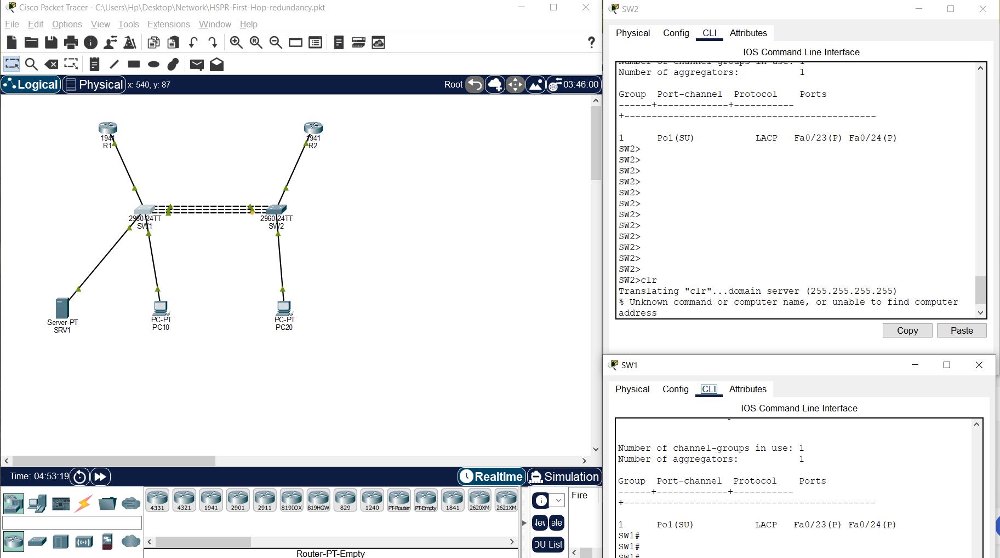

# First-Hop Redundancy and LACP Evidence

Redundant topology with captured EtherChannel output.

## Lab file

[Open or download the Packet Tracer lab](./HSPR-First-Hop-redundancy.pkt). Open the file in Cisco Packet Tracer; if compatibility warnings appear, use a compatible release and work from a copy.

## Supplied evidence

The screenshot window identifies HSPR-First-Hop-redundancy.pkt. Both switches display Po1(SU), protocol LACP, and Fa0/23(P) plus Fa0/24(P). This captures an active Layer 2 port-channel with bundled members; it does not demonstrate HSRP failover.

## Verification checklist

These are proposed checks to run in Packet Tracer, not recorded test results.

- [ ] Inspect show standby brief to verify any configured HSRP groups.
- [ ] Check show etherchannel summary on both switches.
- [ ] Test link and gateway failures separately and capture recovery results.

## Documentation status

The original binary lab is preserved. Topic labels are based on its filename and any supplied screenshot. The saved device configurations have not been inspected or simulated for this portfolio update.

To complete the case study, record the topology, addressing plan, relevant configuration, command output, and observed troubleshooting or failover results.
